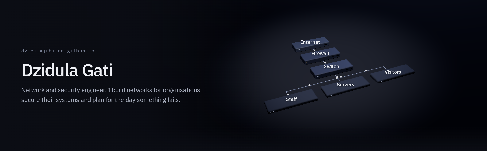

I design and build networks for organisations, secure the systems on them, and write the disaster recovery plans that get a site back up when something fails. When off-the-shelf tools don't fit, I write my own. Most of them end up here, open source and self-hosted.

**Portfolio** [dzidulajubilee.github.io](https://dzidulajubilee.github.io) &nbsp;·&nbsp; **Email** [dzidulajubilee@gmail.com](mailto:dzidulajubilee@gmail.com)

### Security tooling

| Project | What it does |
| --- | --- |
| [**Pantomath**](https://github.com/dzidulajubilee/Pantomath) | Threat-intel aggregator. Scores feed items, extracts CVEs and IOCs, flags anything on CISA KEV that affects your stack, and serves an IOC lookup API to SIEMs |
| [**Heimdall**](https://github.com/dzidulajubilee/Heimdall) | Airgapped IDS dashboard for Suricata, with live alerts over SSE, triage, a signature knowledge base and RBAC. Ships as a `.deb` |
| [**Watcher**](https://github.com/dzidulajubilee/Watcher) | Real-time Suricata console for alerts, flows, DNS and HTTP events |
| [**OT-Security-Modbus**](https://github.com/dzidulajubilee/OT-Security-Modbus) | Modbus TCP discovery and fingerprinting for industrial networks |

**Wazuh integrations:** [Yeti](https://github.com/dzidulajubilee/Wazuh-Yeti) IOC lookups &nbsp;·&nbsp; [TheHive](https://github.com/dzidulajubilee/Incident_Routing) incident routing &nbsp;·&nbsp; [Casebender](https://github.com/dzidulajubilee/Wazuh-Casebender) cases &nbsp;·&nbsp; [n8n](https://github.com/dzidulajubilee/Wazuh-n8n) workflows

### Hands-on with

Juniper SRX &nbsp;·&nbsp; UniFi &nbsp;·&nbsp; VLAN segmentation &nbsp;·&nbsp; IPsec and WireGuard &nbsp;·&nbsp; keepalived &nbsp;·&nbsp; Proxmox VE and ZFS &nbsp;·&nbsp; Suricata &nbsp;·&nbsp; Wazuh &nbsp;·&nbsp; Pi-hole and Technitium &nbsp;·&nbsp; Postfix and DKIM &nbsp;·&nbsp; Windows Server and Active Directory &nbsp;·&nbsp; Python &nbsp;·&nbsp; Go &nbsp;·&nbsp; Bash &nbsp;·&nbsp; PowerShell
